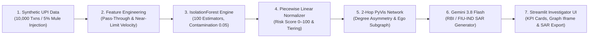

<div align="center">

# 🛡️ Indian UPI Mule Account Anomaly & FIU-IND Compliance Workbench

**Real-Time Detection of Illicit Financial Flows, Rapid Layering, and Post-KYC Mule Accounts in UPI Networks**

[](https://www.python.org/)
[](https://streamlit.io/)
[](https://scikit-learn.org/)
[](https://networkx.org/)
[](https://ai.google.dev/)
[](#-project-overview)

<br />

```
Synthetic UPI Data  ──►  IsolationForest Scorer  ──►  2-Hop PyVis Graph  ──►  Gemini FIU-IND SAR
```

</div>

---

### 📌 Project Overview

The **Indian UPI Mule Account Anomaly & FIU-IND Compliance Workbench** is an automated forensic intelligence engine engineered to uncover money mule syndicates operating across Unified Payments Interface (UPI) payment rails. 

Traditional Anti-Money Laundering (AML) solutions rely heavily on static Know-Your-Customer (KYC) identity checks, which fail against "clean skin" or compromised third-party accounts activated legitimately and subsequently weaponized for smurfing, layering, and instant fund drainage. 

This workbench unites **unsupervised machine learning anomaly scoring**, **graph topological degree asymmetry analytics**, and **generative LLM Suspicious Activity Report (SAR) drafting** within an interactive single-page Streamlit investigator cockpit.

---

### ⚡ System Architecture Flow



1. **Synthetic UPI Data Pipeline (`src/data_pipeline.py`)**: Simulates 10,000 transactions over 24 hours with 5 independent mule syndicates exhibiting rapid fan-in layering and near-instant balance pass-through.
2. **IsolationForest Anomaly Scorer (`src/ml_engine.py`)**: Evaluates transaction amounts, pass-through ratios, and structuring velocity; transforms raw outlier decision scores into an intuitive 0–100 Risk Score.
3. **Graph Topology Engine (`src/graph_engine.py`)**: Extracts the 2-hop ego transaction neighborhood around suspect accounts, calculating degree asymmetry to distinguish Fan-In Aggregators from Pass-Through Relays.
4. **FIU-IND Regulatory SAR Generator (`src/sar_generator.py`)**: Synthesizes formal, two-paragraph Suspicious Activity Reports adhering to PMLA 2002 and RBI KYC Master Directions via Gemini 3.8 Flash, backed by an offline deterministic fallback.
5. **Streamlit Investigator Workbench (`ui/app.py`)**: Presents executive KPI metrics, interactive PyVis network visualizations, evidence pills, and one-click regulatory SAR downloads.

---

### 🚀 Quickstart Guide

#### 1. Clone & Set Up Virtual Environment

```bash
# Clone the repository and navigate into the workspace
git clone <repo-url>
cd "Mule account prototype ver 1(test case)"

# Create and activate Python virtual environment
python3 -m venv venv
source venv/bin/activate  # On Windows: .\venv\Scripts\activate
```

#### 2. Install Dependencies

```bash
pip install -r requirements.txt
```

#### 3. Run Data & Machine Learning Pipelines

```bash
# Generate synthetic UPI dataset with engineered features
python src/data_pipeline.py

# Train IsolationForest model and score accounts
python src/ml_engine.py
```

#### 4. Launch Streamlit Investigator Dashboard

```bash
# Launch single-page interactive UI (default: http://localhost:8501)
streamlit run ui/app.py
```

*(Optional)* Create a `.env` file in the project root with your Gemini API key, or provide it via the password-masked sidebar input in the dashboard:
```bash
GEMINI_API_KEY=your_gemini_api_key_here
```

---

### 🧪 Demo Test Accounts

The dashboard features preset accounts demonstrating distinct behavioral archetypes:

| Preset Account | Risk Tier | Risk Score | Behavioral Profile |
| :--- | :---: | :---: | :--- |
| `mule_c1_hub01@ybl` | 🔴 **HIGH** | `92.88` | **Aggregator Hub Mule** — 98.10% pass-through ratio, 24 rapid near-limit credits immediately swept to cash-out endpoints within 2 minutes. |
| `employer_03@sbi` | 🟡 **MEDIUM** | `70.45` | **Corporate Payroll Source** — High-volume legitimate batch disbursements requiring step-up transaction monitoring without account freezing. |
| `user_0130@okaxis` | 🔵 **LOW** | `18.23` | **Retail Consumer** — Standard peer-to-merchant domestic payments, low balance velocity, and no layering indicators. |

---

### 📁 Project Structure

```
.
├── .streamlit/
│   └── config.toml                  # Dark fintech UI theme configuration
├── data/
│   ├── upi_mule_features.csv        # Synthetic UPI dataset with engineered features
│   ├── scored_upi_data.csv          # IsolationForest inference output with Risk Scores
│   └── network.html                 # Default static PyVis subgraph export
├── docs/
│   ├── CHANGELOG.md                 # Exhaustive development history (Phases 1–4)
│   └── Mule_Account_Detector_v1_Changelog.pdf  # Executive changelog and architecture PDF report
├── models/
│   ├── iso_forest.joblib            # Serialized Scikit-Learn IsolationForest model
│   └── generations/                 # Immutable generation snapshots with SHA-256 validation
├── src/
│   ├── data_pipeline.py             # Synthetic UPI simulation & feature engineering
│   ├── ml_engine.py                 # IsolationForest scoring & analyze_account() API
│   ├── graph_engine.py              # NetworkX 2-hop graph extraction & PyVis rendering
│   └── sar_generator.py             # Gemini 3.8 Flash FIU-IND compliance report generator
├── ui/
│   └── app.py                       # Single-page Streamlit investigator cockpit
├── requirements.txt                 # Pinned project dependencies
└── README.md                        # Project documentation
```

---

### 🛡️ Security & Quality Verification

All source modules (`src/`, `ui/`) have been audited and hardened:
- **CodeRabbit**: Verified 0 critical findings across data pipeline, ML engine, graph engine, and Streamlit workbench.
- **Semgrep**: Scanned with 290 security rules — 0 findings.
- **Snyk Code & SCA**: Validated Python code and dependency graph — 0 vulnerabilities.
- **CWE-668 / CWE-79 Mitigations**: Session-isolated API key overrides (no process-wide `os.environ` pollution) and HTML-escaped node tooltips in PyVis graphs.

---

### 📜 Regulatory References
- **Reserve Bank of India (RBI)**: Master Direction - Know Your Customer (KYC) Direction, 2016 (Updated).
- **Financial Intelligence Unit - India (FIU-IND)**: Prevention of Money Laundering Act (PMLA), 2002.
